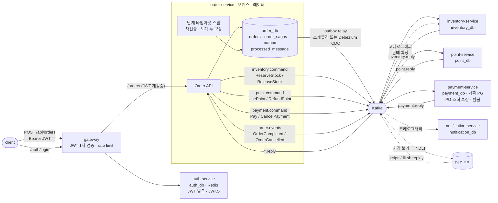

# commerce-saga

커머스 주문(주문·재고·포인트·결제)을 마이크로서비스로 나눈 뒤 생기는 **분산 정합성 문제**를 실제로 재현하고 해결하는 프로젝트.

- 서비스마다 DB가 따로라 분산 트랜잭션을 쓸 수 없다 → **Saga(오케스트레이션)** 와 역순 보상 트랜잭션
- DB 저장과 메시지 발행의 이중 쓰기 → **Transactional Outbox** + relay (스케줄러 → **Debezium CDC**)
- at-least-once 전달로 같은 메시지가 여러 번 온다 → **멱등 처리**, 늦은 응답에 단계가 되돌아가지 않는 상태 머신

> 3단계(신뢰성)까지 완료, `v0.3-reliability`가 완성 기준이다. 멱등 컨슈머·DLT 재처리, Debezium relay(커넥터 중단 복구·relay 비교 측정), 타임아웃·장애 복구(멈춘 Saga 재전송·보상, 결제 타임아웃 PG 조회 보정, 늦은 승인 자동 환불). 후속 1(관측성)도 완료: 분산 트레이싱(주문 한 건 = trace 하나), 메트릭·경보(결제 UNKNOWN·환불 대기·멈춘 Saga·lag·DLT·slot 적체). 후속 2(인증 + 프론트엔드)도 완료: 자체 JWT auth-service, Spring Cloud Gateway, 서비스 JWT 검증, 프론트용 백엔드 보강(내 주문·결제·포인트 내역, 주문 Idempotency-Key, 가입 → 포인트 계정), Next.js 화면(로그인·가입, 상품·주문·주문 상세 Saga 타임라인, 포인트·결제 내역·알림, 로그인 기기 관리, 관리자 결제 장애 주입)과 CI 브라우저 e2e. 그다음 k8s → 검색. 진행 현황은 [PROGRESS](docs/PROGRESS.md), 전체 계획과 설계 근거는 [브리프](docs/commerce-msa-portfolio-brief.md), 왜 이 규모에 서비스를 나눴는지는 [ADR 0000](docs/adr/0000-why-msa.md).

## 아키텍처 (3단계)



```
정방향: RESERVING_STOCK -> USING_POINT -> PAYING -> COMPLETED
보상:   (실패) -> REFUNDING_POINT -> RELEASING_STOCK -> CANCELLED
결제 포기: PAYING -(응답 없음)-> CANCELLING_PAYMENT -> REFUNDING_POINT -> RELEASING_STOCK -> CANCELLED
```

- 모든 메시지는 outbox를 거친다: 비즈니스 변경 + outbox 저장 = 한 트랜잭션, relay가 Kafka로 발행. relay는 스케줄러([libs/outbox](libs/outbox), 코드 기본값) 또는 Debezium Outbox Event Router([infra/connect](infra/connect), 운영 기준) ([ADR 0004](docs/adr/0004-debezium-outbox-relay.md))
- 메인 Saga는 order-service가 상태 머신(`OrderSaga`)으로 오케스트레이션, 후속 처리는 `order.events` 코레오그래피 ([ADR 0003](docs/adr/0003-orchestration-for-main-saga.md))
- 메시지 키 = `orderId` (주문 단위 순서 보장), 커맨드·응답·이벤트 토픽 분리 ([ADR 0005](docs/adr/0005-message-key-and-topic-rules.md))
- 멱등 컨슈머 두 겹: 같은 메시지의 재전달은 `processed_message`(헤더 `id`)로 건너뛰고, 내용이 같은 재요청은 주문별 처리 기록(예약·사용·결제)으로 한 번만 반영한다 ([ADR 0006](docs/adr/0006-idempotent-consumer.md)). 처리할 수 없는 메시지는 `<토픽>.DLT`
- 분산 트레이싱: outbox 행에 넣는 시점의 `traceparent`를 저장하고 relay가 Kafka 헤더로 옮겨, 주문 한 건이 서비스를 몇 개 지나도 trace 하나 ([ADR 0013](docs/adr/0013-observability.md))
- 메트릭·경보: 서비스마다 자기 DB 기준의 Saga·결제·outbox 메트릭(`/actuator/prometheus`), kafka-exporter 로 lag·DLT, Prometheus 경보 규칙(`infra/prometheus/rules`), Grafana 대시보드 ([ADR 0013](docs/adr/0013-observability.md))
- 인증(후속 2): auth-service 가 access token(JWT RS256, 15분)을 발급하고 공개키를 JWKS 로 낸다. refresh token 은 httpOnly 쿠키, 쓸 때마다 회전하고 옛 토큰을 다시 쓰면 그 기기 세션을 버린다. 요청은 Spring Cloud Gateway(:8000)가 1차로 검증·라우팅·사용자별 rate limit 하고, 서비스마다 다시 검증해 토큰의 `sub` 로 소유권을 본다 ([ADR 0008](docs/adr/0008-auth-self-issued-jwt.md)). 가입은 `auth.events`(`UserRegistered`, outbox)로 알리고 point-service 가 멱등하게 포인트 계정을 만든다(시나리오 13)
- 서비스 내부는 헥사고날 + DDD 애그리거트 ([ADR 0002](docs/adr/0002-persistence-domain-jpa-separation.md)), 서비스별 DB·계정 분리 ([ADR 0001](docs/adr/0001-monorepo-independent-deploy.md))

## 실행

```bash
docker compose -f infra/docker-compose.yml up -d --wait     # Postgres, Kafka, Kafka UI(http://localhost:8989), Tempo·Prometheus(9091)·Grafana(http://localhost:3030), Redis(6380)
./gradlew :services:inventory-service:bootRun              # 8082   (각각 다른 터미널에서)
./gradlew :services:point-service:bootRun                  # 8083
./gradlew :services:payment-service:bootRun                # 8084
./gradlew :services:order-service:bootRun                  # 8081
./gradlew :services:notification-service:bootRun           # 8085 (선택)
./gradlew :services:auth-service:bootRun                   # 8086 회원·로그인 (Redis 6380)
./gradlew :services:gateway:bootRun                        # 8000 API Gateway (/auth/**, /api/**)
(cd frontend && npm ci && npm run dev)                 # 화면 http://localhost:3500. frontend/README.md
```

```bash
TOKEN=$(curl -s -X POST localhost:8000/auth/login -H 'Content-Type: application/json' \
  -d '{"loginId":"user1","password":"local-dev-pass"}' | sed -nE 's/.*"accessToken":"([^"]+)".*/\1/p')   # 개발용 시드 사용자 1
curl -X POST localhost:8000/api/orders -H "Authorization: Bearer $TOKEN" -H 'Content-Type: application/json' \
  -H "Idempotency-Key: $(uuidgen)" \
  -d '{"lines":[{"productId":1,"quantity":2,"unitPrice":1000}],"pointAmount":500}'   # 같은 키로 다시 보내면 처음 주문(200)
curl localhost:8000/api/orders/<orderId> -H "Authorization: Bearer $TOKEN"        # PENDING -> COMPLETED
curl localhost:8000/api/orders/<orderId>/saga -H "Authorization: Bearer $TOKEN"   # Saga 단계 타임라인 (본인 주문만)
curl localhost:8000/api/orders?size=20 -H "Authorization: Bearer $TOKEN"          # 내 주문 목록 (최신순, 다음 쪽은 before=<마지막 orderId>). 결제는 /api/payments
scripts/smoke-saga.sh                                      # 정상·품절·결제 실패 보상·소유권 검사 한 번에
scripts/dlt.sh list inventory.command.DLT                  # 처리 못 한 메시지와 원인 (replay 로 재처리)
scripts/smoke-tracing.sh                                   # 주문 한 건 = trace 하나 (Grafana → Explore → Tempo 에서 trace 보기)
scripts/smoke-alerts.sh                                    # 장애 → 경보 firing (Grafana 대시보드 commerce-saga)
scripts/smoke-auth.sh                                      # 가입·로그인·refresh 회전·재사용 탐지 (auth-service 를 AUTH_REFRESH_GRACE=2s 로 띄우면 GRACE_WAIT=3 로 빨리)
scripts/smoke-gateway.sh                                   # Gateway·서비스 JWT 검증, 남의 주문 404, 관리자 역할, rate limit
scripts/smoke-idempotency.sh                               # 같은 Idempotency-Key 재요청·동시 요청에도 주문 하나, 다른 본문 422, 내 주문·결제 목록
scripts/smoke-signup-points.sh                             # 가입 → auth.events → 포인트 계정(가입 축하 1,000P) → 그 포인트로 주문
```

- JDK 25는 Gradle 툴체인이 자동으로 받는다
- 시드 데이터: 재고 상품 1~3은 100개, 4는 1개, 5는 품절 / 포인트 사용자 1~3은 10,000P, 4는 0P, 새로 가입하면 1,000P(auth.events → point-service) / 로그인 사용자 `user1`~`user4`(id 1~4), `admin`(id 100), 비밀번호 `local-dev-pass` (로컬 개발용, 운영은 `AUTH_FLYWAY_LOCATIONS=classpath:db/migration`)
- 결제 실패 주입(관리자): `curl -X PUT localhost:8000/api/admin/payment-faults -H "Authorization: Bearer $ADMIN_TOKEN" -H 'Content-Type: application/json' -d '{"mode":"DECLINE","delayMillis":0}'` (`admin` 으로 로그인한 토큰)

진행 현황과 다음 작업: [docs/PROGRESS.md](docs/PROGRESS.md)

## 시나리오

| # | 시나리오 | 결과 |
|---|---|---|
| 0 | [기본 흐름: 주문 → 재고 예약 → 확정 / 품절 거절 / 남의 주문 조회 404](docs/scenarios/00-basic-flow.md) | 통과 (CI `e2e`) |
| 1 | [결제 실패 → 포인트 환불 → 재고 해제 (보상 순서)](docs/scenarios/01-payment-failure-compensation.md) | 통과 (CI `e2e`) |
| 2 | [결제 타임아웃 → PG 조회로 확정 / 오래 걸리면 결제 취소·보상 + 늦은 승인 자동 환불](docs/scenarios/02-payment-timeout.md) | 통과 (로컬, CI `e2e`) |
| 3 | [중복 전달: 오프셋 되감기 → 재고·포인트·응답 중복 0건](docs/scenarios/03-duplicate-delivery.md) | 통과 (로컬, CI `e2e`) |
| 4 | [참여 서비스 다운 → 복구 후 이어서 완료 / 오래 다운되면 재전송 포기 후 역순 보상](docs/scenarios/04-service-down.md) | 통과 (로컬, CI `e2e`) |
| 5 | [Debezium 커넥터 중단 → 재개 후 유실 0, slot WAL 적체와 heartbeat](docs/scenarios/05-connector-outage.md) | 통과 (로컬, CI `e2e` debezium) |
| 6 | [poison message → DLT 격리(파티션 안 막힘) → 원인 확인 → 재처리 한 번만 반영](docs/scenarios/06-poison-message-dlt.md) | 통과 (로컬, CI `e2e`) |
| 7 | [relay 비교: 스케줄러 vs Debezium, Saga 완료 지연·DB 부하](docs/scenarios/07-relay-comparison.md) | 측정 (로컬, CI `e2e`) |
| 8 | [알림 서비스 다운 → 주문은 정상 완료, 복구 후 밀린 이벤트 처리](docs/scenarios/08-notification-down.md) | 통과 (CI `e2e`) |
| 9 | [인증: refresh token 회전, 옛 토큰 재사용 → 그 기기 세션 폐기, 로그인 잠금](docs/scenarios/09-auth-refresh-reuse.md), JWT 로 바꾼 뒤 남의 주문 404·Gateway·서비스 이중 검증·rate limit | 통과 (로컬, CI `e2e`) |
| 10 | [주문 Idempotency-Key: 같은 키 재요청·동시 5번 → 주문 1건, 다른 본문 422 / 내 주문·결제 목록](docs/scenarios/10-order-idempotency.md) | 통과 (CI `e2e`) |
| 11 | [분산 트레이싱: Saga 한 건이 서비스 다섯 개를 지나도 trace 하나, 주문 id 로 검색](docs/scenarios/11-distributed-tracing.md) | 통과 (로컬, CI `e2e`) |
| 12 | [메트릭·경보: 깨진 메시지·PG 지연을 넣으면 DLT·결제 UNKNOWN·재전송 포기 경보가 firing](docs/scenarios/12-metrics-alerts.md) | 통과 (로컬, CI `e2e`) |
| 13 | [가입 → auth.events(UserRegistered, outbox) → 포인트 계정 하나·가입 축하 1,000P → 그 포인트로 주문](docs/scenarios/13-signup-point-account.md) | 통과 (CI `e2e`) |

## 설계 결정 (ADR)

- [0000 왜 MSA인가: 이 규모는 모놀리스로 충분하지만 분산 정합성을 검증하려고 나눴다 (메인 Saga 방식 대안 비교)](docs/adr/0000-why-msa.md)
- [0001 모노레포 + 서비스별 독립 실행·배포](docs/adr/0001-monorepo-independent-deploy.md)
- [0002 영속성: 도메인 모델과 JPA 엔티티 분리](docs/adr/0002-persistence-domain-jpa-separation.md)
- [0003 메인 주문 Saga는 오케스트레이션, 후속 처리는 코레오그래피](docs/adr/0003-orchestration-for-main-saga.md)
- [0004 Outbox relay: 운영 기준은 Debezium(CDC), 코드 기본값은 스케줄러 유지](docs/adr/0004-debezium-outbox-relay.md)
- [0005 Kafka 메시지 키 = orderId, 커맨드·응답·이벤트 토픽 분리, 스키마 호환 규칙](docs/adr/0005-message-key-and-topic-rules.md)
- [0006 멱등 컨슈머: 메시지 ID 기록 + 주문별 기록, 두 겹](docs/adr/0006-idempotent-consumer.md)
- [0007 Saga 타임아웃과 결제 타임아웃 보정: 재전송 후 포기하면 역순 보상, 결제는 PG 조회로 확정하고 늦은 승인은 자동 환불](docs/adr/0007-saga-timeout.md)
- [0008 인증: 자체 auth-service 가 JWT(RS256 + JWKS) 발급, refresh token 은 회전(RTR)하고 재사용하면 그 기기 세션 폐기](docs/adr/0008-auth-self-issued-jwt.md)
- [0011 프론트엔드: Next.js + Tailwind + shadcn/ui, Next 서버가 토큰을 httpOnly 쿠키로 들고 Gateway 를 부른다(BFF), refresh 는 proxy.ts](docs/adr/0011-frontend-nextjs-bff-session.md)
- [0012 실패 처리: 일시 오류는 제자리 재시도, 영구 오류는 DLT + 재처리 도구 (retry 토픽 미사용)](docs/adr/0012-retry-in-place-and-dlt.md)
- [0013 관측성: Saga 한 건을 trace 하나로(outbox 를 거쳐도 trace 문맥을 잇는다), 정합성이 깨지기 전에 경보](docs/adr/0013-observability.md)
- [0014 k8s 배포: Helm 차트 하나, Kafka 는 Strimzi, relay 는 Strimzi KafkaConnect 의 Debezium, 검증은 CI 의 kind](docs/adr/0014-k8s-deployment.md)

## 구성

```
services/      order(오케스트레이터), inventory, point, payment(가짜 PG), notification, auth(회원·로그인·JWT 발급), gateway(Spring Cloud Gateway)
libs/          messaging-contract(메시지 스키마), outbox(저장 + relay)
frontend/      Next.js 화면 (로그인·회원가입, 상품·주문·내 주문·주문 상세 Saga 타임라인, 포인트·결제·알림, 로그인 기기, 관리자)
tools/         dlt-replay(DLT 조회·재처리 CLI, scripts/dlt.sh)
build-logic/   공통 빌드 설정
infra/         로컬 인프라 (docker-compose)
deploy/        k8s 배포 (서비스 이미지, Helm 차트, 후속 3). deploy/README.md
scripts/       스모크 테스트, 오프셋 되감기, DLT 조회·재처리, 커넥터 등록·중단 시나리오, 서비스 다운·결제 타임아웃 시나리오, relay 측정
docs/          ADR, 시나리오
```

## 기술 스택

Java 25, Spring Boot 4.2, Gradle Kotlin DSL(멀티모듈), PostgreSQL 18, Flyway, Kafka 4.4(KRaft), Kafka Connect + Debezium 3.7, Spring for Apache Kafka, OpenTelemetry(OTLP) + Grafana Tempo, Prometheus + Grafana, Spring Cloud Gateway, Spring Security(OAuth2 Resource Server, JWT RS256), Redis, Testcontainers, ArchUnit
