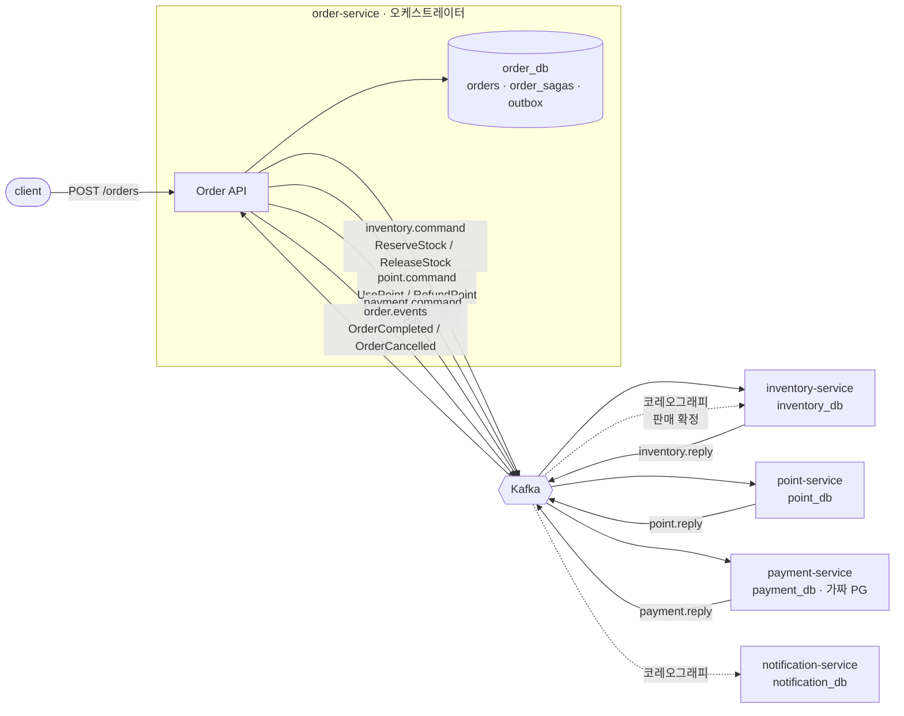

# commerce-saga

커머스 주문(주문·재고·포인트·결제)을 마이크로서비스로 나눈 뒤 생기는 **분산 정합성 문제**를 실제로 재현하고 해결하는 프로젝트.

- 서비스마다 DB가 따로라 분산 트랜잭션을 쓸 수 없다 → **Saga(오케스트레이션)** 와 역순 보상 트랜잭션
- DB 저장과 메시지 발행의 이중 쓰기 → **Transactional Outbox** + relay (스케줄러 → **Debezium CDC**)
- at-least-once 전달로 같은 메시지가 여러 번 온다 → **멱등 처리**, 늦은 응답에 단계가 되돌아가지 않는 상태 머신

> 진행 중: 2단계(Saga 완성) 완료. 전체 계획과 설계 근거는 [브리프](docs/commerce-msa-portfolio-brief.md).

## 아키텍처 (2단계)



```
정방향: RESERVING_STOCK -> USING_POINT -> PAYING -> COMPLETED
보상:   (실패) -> REFUNDING_POINT -> RELEASING_STOCK -> CANCELLED
```

- 모든 메시지는 outbox를 거친다: 비즈니스 변경 + outbox 저장 = 한 트랜잭션, 스케줄러 relay가 Kafka로 발행 ([libs/outbox](libs/outbox))
- 메인 Saga는 order-service가 상태 머신(`OrderSaga`)으로 오케스트레이션, 후속 처리는 `order.events` 코레오그래피 ([ADR 0003](docs/adr/0003-orchestration-for-main-saga.md))
- 메시지 키 = `orderId` (주문 단위 순서 보장), 커맨드·응답·이벤트 토픽 분리 ([ADR 0005](docs/adr/0005-message-key-and-topic-rules.md))
- 멱등 컨슈머 두 겹: 같은 메시지의 재전달은 `processed_message`(헤더 `id`)로 건너뛰고, 내용이 같은 재요청은 주문별 처리 기록(예약·사용·결제)으로 한 번만 반영한다 ([ADR 0006](docs/adr/0006-idempotent-consumer.md)). 처리할 수 없는 메시지는 `<토픽>.DLT`
- 서비스 내부는 헥사고날 + DDD 애그리거트 ([ADR 0002](docs/adr/0002-persistence-domain-jpa-separation.md)), 서비스별 DB·계정 분리 ([ADR 0001](docs/adr/0001-monorepo-independent-deploy.md))

## 실행

```bash
docker compose -f infra/docker-compose.yml up -d --wait     # Postgres, Kafka, Kafka UI(http://localhost:8989)
./gradlew :services:inventory-service:bootRun              # 8082   (각각 다른 터미널에서)
./gradlew :services:point-service:bootRun                  # 8083
./gradlew :services:payment-service:bootRun                # 8084
./gradlew :services:order-service:bootRun                  # 8081
./gradlew :services:notification-service:bootRun           # 8085 (선택)
```

```bash
curl -X POST localhost:8081/orders -H 'X-User-Id: 1' -H 'Content-Type: application/json' \
  -d '{"lines":[{"productId":1,"quantity":2,"unitPrice":1000}],"pointAmount":500}'
curl localhost:8081/orders/<orderId> -H 'X-User-Id: 1'      # PENDING -> COMPLETED
curl localhost:8081/orders/<orderId>/saga -H 'X-User-Id: 1' # Saga 단계 타임라인 (본인 주문만)
scripts/smoke-saga.sh                                      # 정상·품절·결제 실패 보상·소유권 검사 한 번에
scripts/dlt.sh list inventory.command.DLT                  # 처리 못 한 메시지와 원인 (replay 로 재처리)
```

- JDK 25는 Gradle 툴체인이 자동으로 받는다
- 시드 데이터: 재고 상품 1~3은 100개, 4는 1개, 5는 품절 / 포인트 사용자 1~3은 10,000P, 4는 0P
- 결제 실패 주입: `curl -X PUT localhost:8084/admin/payment-faults -H 'Content-Type: application/json' -d '{"mode":"DECLINE","delayMillis":0}'`

진행 현황과 다음 작업: [docs/PROGRESS.md](docs/PROGRESS.md)

## 시나리오

| # | 시나리오 | 결과 |
|---|---|---|
| 0 | [기본 흐름: 주문 → 재고 예약 → 확정 / 품절 거절 / 남의 주문 조회 404](docs/scenarios/00-basic-flow.md) | 통과 (CI `e2e`) |
| 1 | [결제 실패 → 포인트 환불 → 재고 해제 (보상 순서)](docs/scenarios/01-payment-failure-compensation.md) | 통과 (CI `e2e`) |
| 3 | [중복 전달: 오프셋 되감기 → 재고·포인트·응답 중복 0건](docs/scenarios/03-duplicate-delivery.md) | 통과 (로컬, CI `e2e`) |
| 6 | [poison message → DLT 격리(파티션 안 막힘) → 원인 확인 → 재처리 한 번만 반영](docs/scenarios/06-poison-message-dlt.md) | 통과 (로컬, CI `e2e`) |
| 8 | [알림 서비스 다운 → 주문은 정상 완료, 복구 후 밀린 이벤트 처리](docs/scenarios/08-notification-down.md) | 통과 (CI `e2e`) |

이후 단계: 결제 타임아웃 보정, 서비스 다운 복구, Debezium 커넥터 중단, relay 지연 비교 ([브리프 6절](docs/commerce-msa-portfolio-brief.md#6-보여줄-시나리오-docsscenarios)).

## 설계 결정 (ADR)

- [0001 모노레포 + 서비스별 독립 실행·배포](docs/adr/0001-monorepo-independent-deploy.md)
- [0002 영속성: 도메인 모델과 JPA 엔티티 분리](docs/adr/0002-persistence-domain-jpa-separation.md)
- [0003 메인 주문 Saga는 오케스트레이션, 후속 처리는 코레오그래피](docs/adr/0003-orchestration-for-main-saga.md)
- [0005 Kafka 메시지 키 = orderId, 커맨드·응답·이벤트 토픽 분리, 스키마 호환 규칙](docs/adr/0005-message-key-and-topic-rules.md)
- [0006 멱등 컨슈머: 메시지 ID 기록 + 주문별 기록, 두 겹](docs/adr/0006-idempotent-consumer.md)
- [0012 실패 처리: 일시 오류는 제자리 재시도, 영구 오류는 DLT + 재처리 도구 (retry 토픽 미사용)](docs/adr/0012-retry-in-place-and-dlt.md)

## 구성

```
services/      order(오케스트레이터), inventory, point, payment(가짜 PG), notification
libs/          messaging-contract(메시지 스키마), outbox(저장 + relay)
tools/         dlt-replay(DLT 조회·재처리 CLI, scripts/dlt.sh)
build-logic/   공통 빌드 설정
infra/         로컬 인프라 (docker-compose)
scripts/       스모크 테스트, 오프셋 되감기, DLT 조회·재처리, (이후) 커넥터 등록·부하·장애 주입
docs/          ADR, 시나리오
```

## 기술 스택

Java 25, Spring Boot 4.1, Gradle Kotlin DSL(멀티모듈), PostgreSQL 18, Flyway, Kafka 4.3(KRaft), Spring for Apache Kafka, Testcontainers, ArchUnit
