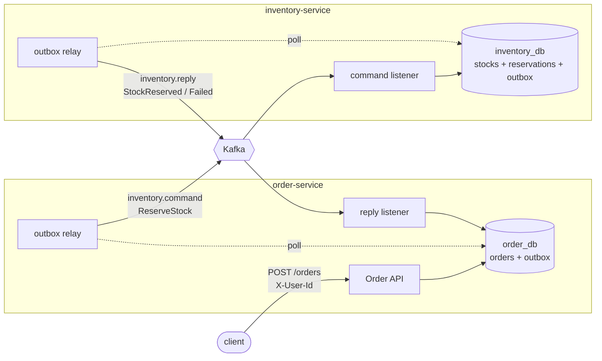

# commerce-saga

커머스 주문(주문·재고·포인트·결제)을 마이크로서비스로 나눈 뒤 생기는 **분산 정합성 문제**를 실제로 재현하고 해결하는 프로젝트.

- 서비스마다 DB가 따로라 분산 트랜잭션을 쓸 수 없다 → **Saga(오케스트레이션)** 와 보상 트랜잭션
- DB 저장과 메시지 발행의 이중 쓰기 → **Transactional Outbox** + relay (스케줄러 → **Debezium CDC**)
- at-least-once 전달로 같은 메시지가 여러 번 온다 → **멱등 컨슈머**, 늦은 응답에 상태가 되돌아가지 않는 상태 전이

> 진행 중: 1단계(기본 흐름) 완료. 전체 계획과 설계 근거는 [브리프](docs/commerce-msa-portfolio-brief.md).

## 아키텍처 (1단계)



- 주문 저장과 `ReserveStock` outbox 저장이 한 트랜잭션, 재고 예약과 응답 outbox 저장이 한 트랜잭션
- Kafka 메시지 키 = `orderId` (주문 단위 순서 보장). 토픽·메시지 규칙은 [ADR 0005](docs/adr/0005-message-key-and-topic-rules.md)
- 서비스 내부는 헥사고날 + DDD 애그리거트 ([ADR 0002](docs/adr/0002-persistence-domain-jpa-separation.md))

## 실행

```bash
docker compose -f infra/docker-compose.yml up -d --wait      # Postgres, Kafka, Kafka UI(http://localhost:8989)
./gradlew :services:order-service:bootRun                   # 8081
./gradlew :services:inventory-service:bootRun               # 8082
```

```bash
curl -X POST localhost:8081/orders -H 'X-User-Id: 1' -H 'Content-Type: application/json' \
  -d '{"lines":[{"productId":1,"quantity":2,"unitPrice":1000}]}'
curl localhost:8081/orders/<orderId> -H 'X-User-Id: 1'      # PENDING -> CONFIRMED
scripts/smoke-basic-flow.sh                                  # 정상·품절·소유권 검사 한 번에
```

JDK 25는 Gradle 툴체인이 자동으로 받는다. 시드 재고: 상품 1~3은 100개, 4는 1개, 5는 품절.

## 시나리오

| # | 시나리오 | 결과 |
|---|---|---|
| 0 | [기본 흐름: 주문 → 재고 예약 → 확정 / 품절 거절 / 남의 주문 조회 404](docs/scenarios/00-basic-flow.md) | 통과 (CI `e2e`) |

이후 단계: 결제 실패 보상, 결제 타임아웃 보정, 중복 전달, 서비스 다운 복구, Debezium 커넥터 중단, DLQ, relay 지연 비교, 장애 격리 ([브리프 6절](docs/commerce-msa-portfolio-brief.md#6-보여줄-시나리오-docsscenarios)).

## 설계 결정 (ADR)

- [0001 모노레포 + 서비스별 독립 실행·배포](docs/adr/0001-monorepo-independent-deploy.md)
- [0002 영속성: 도메인 모델과 JPA 엔티티 분리](docs/adr/0002-persistence-domain-jpa-separation.md)
- [0005 Kafka 메시지 키 = orderId, 커맨드·응답·이벤트 토픽 분리](docs/adr/0005-message-key-and-topic-rules.md)

## 구성

```
services/      order-service, inventory-service (이후 point, payment, notification ...)
libs/          messaging-contract(메시지 스키마), outbox(저장 + relay)
build-logic/   공통 빌드 설정
infra/         로컬 인프라 (docker-compose)
scripts/       스모크 테스트, (이후) 커넥터 등록·부하·장애 주입
docs/          ADR, 시나리오
```

## 기술 스택

Java 25, Spring Boot 4.1, Gradle Kotlin DSL(멀티모듈), PostgreSQL 18, Flyway, Kafka 4.3(KRaft), Spring for Apache Kafka, Testcontainers, ArchUnit
