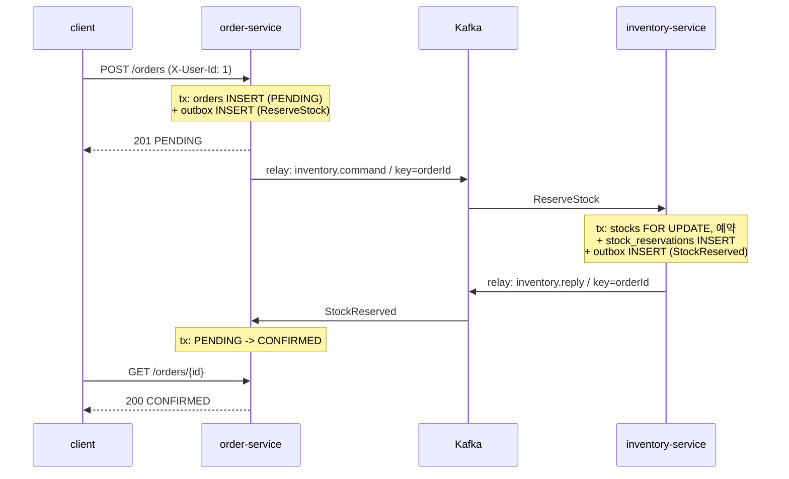

# 시나리오 0. 기본 흐름

주문 → 재고 예약 → 주문 확정이 outbox + Kafka로 서비스 사이를 오가는지, 품절이면 아무 재고도 잡지 않고 거절되는지, 남의 주문은 조회되지 않는지 확인한다.

## 흐름



## 재현

```bash
docker compose -f infra/docker-compose.yml up -d --wait
./gradlew :services:order-service:bootRun
./gradlew :services:inventory-service:bootRun
scripts/smoke-basic-flow.sh
```

CI에서는 `.github/workflows/e2e.yml`이 같은 순서로 jar를 띄워 매 PR마다 돌린다.

## 기대 결과

| # | 동작 | 기대 |
|---|---|---|
| 1 | 상품 1을 2개 주문 | 생성 직후 `PENDING`, 잠시 후 `CONFIRMED`. 상품 1 `available` -2, `reserved` +2 |
| 2 | 상품 2(재고 있음) + 상품 5(품절)를 한 주문으로 | `REJECTED`, `rejectReason = insufficient stock: productId=5`. 상품 2 재고도 그대로 (전부 아니면 전무) |
| 3 | 사용자 2가 사용자 1의 주문 조회 | `404` (존재 여부도 숨김) |

## 실제 결과

CI `e2e` 실행 로그 ([2026-11-22 실행](https://github.com/klmin/commerce-saga/actions/runs/45023168936), GitHub Actions ubuntu-latest, 스케줄러 relay 주기 200ms):

```
== 1. 재고 있는 상품 주문 -> CONFIRMED
  ok  생성 직후 status = PENDING
  ok  orderId=86fcd0bc-39d8-4441-9674-d36c59b279e4 CONFIRMED (1277ms)
  ok  상품 1 available = 98
  ok  상품 1 reserved = 2
== 2. 품절 상품 포함 주문 -> REJECTED, 아무 재고도 잡지 않음
  ok  rejectReason = insufficient stock: productId=5
  ok  상품 2 available = 100
== 3. 다른 사용자의 주문 조회 -> 404
  ok  user 2 -> user 1 주문 = 404
PASS (주문 생성 -> CONFIRMED 1277ms)
```

세 항목 모두 기대 결과와 같다.

## 관련 테스트

- `OrderFlowIntegrationTest`: outbox → relay → `inventory.command` 발행, 발행 후 outbox 행 삭제, 응답 수신 후 상태 반영, 중복·늦은 응답 무시
- `ReserveStockIntegrationTest`: 커맨드 수신 → 예약 → 응답 발행, 같은 커맨드 재전송 시 재고 한 번만 차감, 품절 시 아무것도 잡지 않음
- `OrderTest`, `StockServiceTest`: 상태 전이·전부 아니면 전무 규칙 단위 테스트

## 알게 된 점

- 생성 → 확정 1277ms는 서비스 기동 직후 첫 주문 한 건이라 JIT·커넥션·컨슈머 첫 poll 같은 워밍업이 섞인 값이다. 구조적으로는 relay 폴링 주기(최대 200ms)가 두 번(order → inventory, inventory → order) 더해진다
- 2단계에서 Saga 단계가 4개로 늘면 폴링 지연이 단계마다 누적된다. 워밍업을 뺀 반복 측정(k6)은 3단계 Debezium 전환과 비교하는 시나리오 7에서 한다
