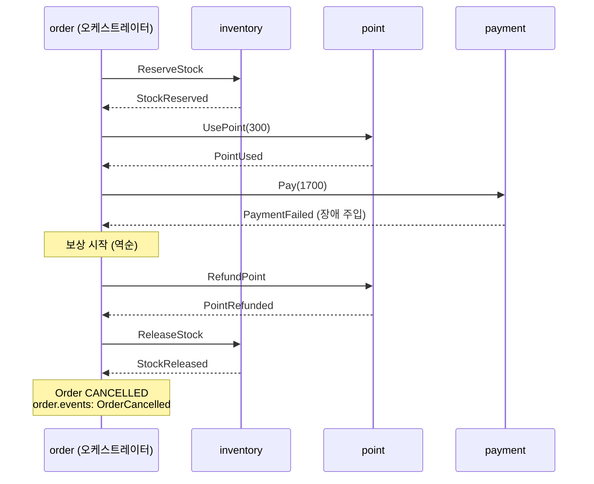

# 시나리오 1. 결제 실패 → 포인트 환불 → 재고 해제 (보상 순서)

결제가 거절되면 이미 성공한 앞 단계(재고 예약, 포인트 차감)를 **정방향의 역순으로** 되돌리고 주문을 취소하는지 확인한다. 재고·포인트가 하나도 새지 않아야 한다.

## 흐름



## 재현

```bash
docker compose -f infra/docker-compose.yml up -d --wait
# 네 서비스 bootRun (inventory 8082, point 8083, payment 8084, order 8081)

curl -X PUT localhost:8084/admin/payment-faults -H 'Content-Type: application/json' -d '{"mode":"DECLINE","delayMillis":0}'
curl -X POST localhost:8081/orders -H 'X-User-Id: 2' -H 'Content-Type: application/json' \
  -d '{"lines":[{"productId":3,"quantity":1,"unitPrice":2000}],"pointAmount":300}'
curl localhost:8081/orders/<orderId>/saga -H 'X-User-Id: 2'   # 단계 타임라인
curl -X PUT localhost:8084/admin/payment-faults -H 'Content-Type: application/json' -d '{"mode":"APPROVE","delayMillis":0}'
```

`scripts/smoke-saga.sh`의 3번이 위 과정을 자동으로 하고 결과를 검증한다 (CI `e2e`).

## 기대 결과

| 항목 | 기대 |
|---|---|
| 주문 | `CANCELLED`, `cancelReason = declined by PG (fault injection)` |
| 포인트 | 주문 전 잔액 그대로 (차감 300 → 환불 300) |
| 재고 | 상품 3 `available`, `reserved` 모두 주문 전 그대로 |
| Saga 타임라인 | `PAYING → REFUNDING_POINT → RELEASING_STOCK → CANCELLED` (포인트 환불이 재고 해제보다 먼저) |
| 이벤트 | `order.events`에 `OrderCancelled` |

## 실제 결과

RESULT_PLACEHOLDER

## 관련 테스트

- `OrderSagaTest.paymentFailed_afterPoints_refundsThenReleasesInReverseOrder`: 전이 순서
- `OrderSagaTest.lateApprovalDuringCompensation_isIgnored`: 보상 중 늦게 온 승인 무시
- `OrderFlowIntegrationTest.paymentFailed_refundsPointThenReleasesStock_thenOrderCancelledEvent`: Kafka 왕복
- `PointServiceTest.duplicateUse...`, `refund_returnsPoints_once...`, `StockServiceTest.duplicateRelease...`: 보상 커맨드가 중복돼도 한 번만 반영

## 알게 된 점

- 보상은 "실패할 수 없는 연산"이어야 Saga가 끝난다. 그래서 `RefundPoint` / `ReleaseStock`은 사용 기록이 없거나 이미 되돌린 경우에도 성공으로 응답하게 계약을 정했다 (예약 전에 해제가 오면 기록을 남겨 늦은 예약도 막는다).
- 결제 서비스는 PG 호출을 트랜잭션 밖에서 하고, PG가 orderId로 멱등이라 재처리 때 이중 승인이 없다. 결과를 알 수 없는 타임아웃의 보정은 시나리오 2(3단계).
