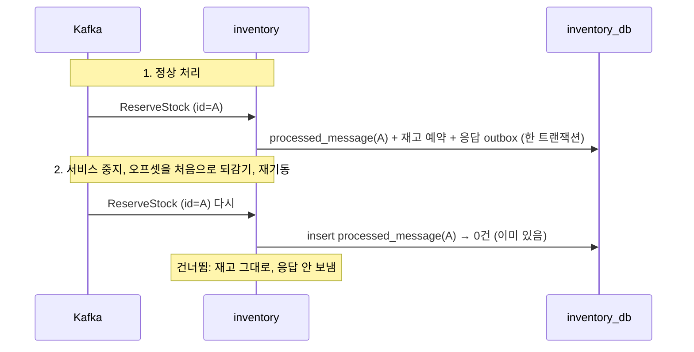

# 시나리오 3. 중복 전달: 컨슈머 오프셋 되감기 → 중복 반영 0건

이미 처리한 메시지를 컨슈머 오프셋을 처음으로 되감아 **전부 다시 전달**해도 재고·포인트·결제가 다시 바뀌지 않고, 응답·이벤트도 새로 나가지 않는지 확인한다. 설계는 [ADR 0006](../adr/0006-idempotent-consumer.md).

## 흐름



## 재현

```bash
docker compose -f infra/docker-compose.yml up -d --wait
# 네 서비스 bootRun (inventory 8082, point 8083, payment 8084, order 8081)
scripts/smoke-saga.sh                       # 주문 몇 건 처리 (완료·품절·결제 실패 보상)
scripts/smoke-redelivery.sh snapshot        # 재고·포인트·토픽 끝 오프셋 기록

# 네 서비스 종료 후 각 컨슈머 그룹을 처음으로 되감기 (그룹 = 서비스 이름)
scripts/rewind-offsets.sh inventory-service inventory.command,order.events
scripts/rewind-offsets.sh point-service point.command
scripts/rewind-offsets.sh payment-service payment.command
scripts/rewind-offsets.sh order-service inventory.reply,point.reply,payment.reply

# 네 서비스 재기동 후
LOG_DIR=logs scripts/smoke-redelivery.sh verify
```

- `rewind-offsets.sh`는 그룹에 컨슈머가 남아 있으면 Kafka가 거부하므로, 서비스를 강제 종료했다면 세션 만료(기본 45초)까지 기다렸다 다시 시도한다
- `verify`는 네 그룹의 lag이 0이 될 때까지(다시 받은 메시지를 다 처리할 때까지) 기다린 뒤 `snapshot`과 비교한다
- CI `e2e`가 `smoke-saga.sh`, 시나리오 8 다음에 이 과정을 그대로 돈다

## 기대 결과

| 항목 | 기대 |
|---|---|
| 재고 (상품 1~5 `available`, `reserved`) | 되감기 전과 같음 |
| 포인트 (user1~user4 잔액) | 되감기 전과 같음 |
| 결제 | PG 재호출 없음 (payment 로그에 건너뜀만) |
| 응답·이벤트 토픽 끝 오프셋 (`*.reply`, `order.events`) | 되감기 전과 같음 = 새로 나간 메시지 0건 |
| 서비스 로그 | 다시 받은 메시지마다 `이미 처리한 메시지(응답) 건너뜀` |

## 실제 결과

로컬 (Windows, Docker Desktop, 빈 인프라에서 `smoke-saga.sh` 1회 후 되감기):

```
== 3. 오프셋 되감기로 전부 다시 전달 -> 재고·포인트·응답 변화 없음
  ok  inventory-service lag 0
  ok  point-service lag 0
  ok  payment-service lag 0
  ok  order-service lag 0
  ok  재고·포인트·토픽 끝 오프셋 모두 그대로 (21 항목)
  ok  inventory-service 재전달 5건 건너뜀
  ok  point-service 재전달 3건 건너뜀
  ok  payment-service 재전달 2건 건너뜀
  ok  order-service 재전달 9건 건너뜀
PASS
```

건너뛴 건수가 다시 받은 메시지 수와 정확히 맞다.

- inventory 5건: `ReserveStock` 3, `ReleaseStock` 1, `OrderCompleted` 1. `OrderCancelled` 2건은 관심 없는 타입이라 기록 없이 건너뛴다
- point 3건: `UsePoint` 2, `RefundPoint` 1
- payment 2건: `Pay` 2
- order 9건: 재고 응답 4, 포인트 응답 3, 결제 응답 2

CI [2026-11-22 실행](https://github.com/klmin/commerce-saga/actions/runs/45033520460) (PR #12, 스케줄러 relay. 서비스를 `pkill`로 내리고 되감은 뒤 다시 띄움):

```
== 3. 오프셋 되감기로 전부 다시 전달 -> 재고·포인트·응답 변화 없음
  ok  inventory-service lag 0
  ok  point-service lag 0
  ok  payment-service lag 0
  ok  order-service lag 0
  ok  재고·포인트·토픽 끝 오프셋 모두 그대로 (21 항목)
  ok  inventory-service 재전달 5건 건너뜀
  ok  point-service 재전달 3건 건너뜀
  ok  payment-service 재전달 2건 건너뜀
  ok  order-service 재전달 9건 건너뜀
PASS
```

로컬과 건수까지 같다. 지금은 CI `e2e`가 relay 두 모드(scheduler, debezium)에서 매 PR마다 돈다.

### 덤으로 확인한 것: 배포 경계

처음에는 이전 단계 데이터가 남은 로컬 Kafka로 돌렸다. 이때 재고·포인트는 그대로였지만 응답 토픽에 메시지가 새로 쌓였다(`inventory.reply` 20 → 36). 원인은 `processed_message`가 생기기 전에 처리한 메시지였다. ID 기록이 없으니 첫 번째 겹은 지나고, 두 번째 겹(주문별 기록)이 상태 중복은 막되 처음 결과를 다시 응답했다. 두 겹이 각자 맡은 일을 하고 있다는 증거이고, ADR 0006 "배포 경계"에 적었다.

## 관련 테스트

- `StockServiceTest.redeliveredMessage_isSkipped_withoutChangingStockOrReplying`: 보상 뒤 늦게 다시 온 원래 메시지까지 건너뜀
- `PointServiceTest`, `PaymentServiceTest`, `OrderServiceTest`의 `redelivered*`
- `ReserveStockIntegrationTest.redeliveredMessage_isSkipped_withoutSecondReply`: Kafka로 같은 `id`를 두 번 보내 응답이 한 번만 나가는지
- `ReserveStockIntegrationTest.processedMessage_requiresTransaction_andRollsBackWithIt`: 트랜잭션 밖 호출은 오류, 롤백되면 기록도 사라짐
- `ReserveStockIntegrationTest.sameMessageConcurrently_*`, `PointIntegrationTest.sameMessageConcurrently_deductsOnce`: 같은 메시지가 **동시에** 두 번 처리될 때. 앞 트랜잭션을 커밋 직전에 멈춰 두면 늦은 쪽은 끝나지 않고 기다린다(PK 선점). 앞이 커밋하면 늦은 쪽은 건너뛰고, 앞이 롤백하면 늦은 쪽이 이어받아 처리한다. 어느 쪽이든 재고·포인트 변경과 응답은 한 번
- 각 리스너 테스트의 `missingOrInvalidIdHeader_isNonRetryable`
