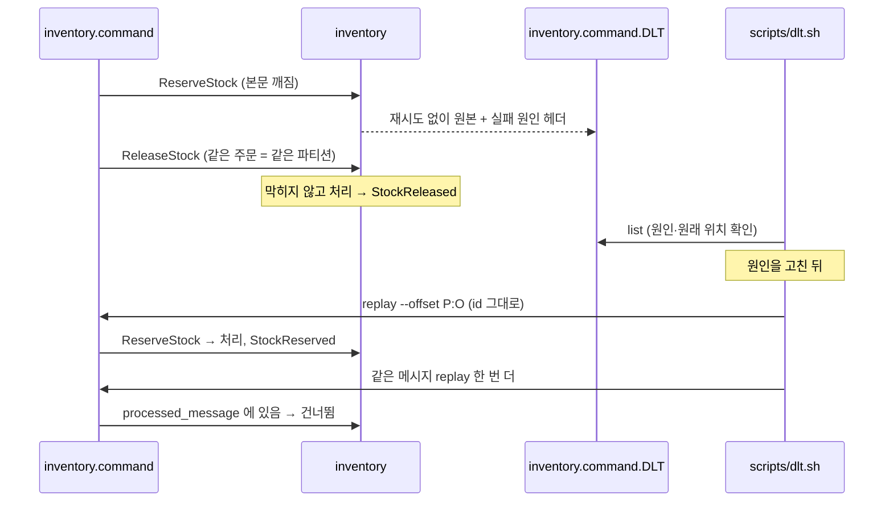

# 시나리오 6. poison message → DLT 격리 → 재처리

처리할 수 없는 메시지(poison message)가 와도 파티션이 막히지 않고, 원본이 실패 원인과 함께 `<토픽>.DLT`에 보존되며, 원인을 고친 뒤 재처리하면 한 번만 반영되는지 확인한다. 설계는 [ADR 0012](../adr/0012-retry-in-place-and-dlt.md).

## 흐름



## 재현

```bash
docker compose -f infra/docker-compose.yml up -d --wait
./gradlew :services:inventory-service:bootRun      # 8082. 이 시나리오는 inventory 하나면 된다
scripts/smoke-poison.sh
```

도구만 따로 쓸 때:

```bash
scripts/dlt.sh list   inventory.command.DLT
scripts/dlt.sh replay inventory.command.DLT --offset 1:0 --dry-run   # 대상만 확인
scripts/dlt.sh replay inventory.command.DLT --offset 1:0
scripts/dlt.sh replay inventory.command.DLT --all
```

`smoke-poison.sh`의 c·d 단계는 "버그 때문에 DLT로 갔던 정상 메시지"가 필요하다. 버그가 있는 버전을 따로 띄울 수 없어서, Spring이 DLT에 남기는 모양(원본 헤더 `id`·`type` + `kafka_dlt-original-topic`)으로 DLT에 직접 넣어 흉내 낸다. 도구 입장에서는 실제로 옮겨진 메시지와 구별되지 않는다.

## 기대 결과

| 단계 | 기대 |
|---|---|
| a. 깨진 JSON의 `ReserveStock` | 재시도 없이 `inventory.command.DLT`로. 같은 주문의 다음 메시지(`ReleaseStock`)는 바로 처리되어 `StockReleased` 응답 |
| b. `dlt.sh list` | key, type, id, 원래 위치(`inventory.command/<파티션>@<오프셋>`), 원인(`tools.jackson.core.exc.StreamReadException ...`) |
| c. 정상 메시지 재처리 | 원래 토픽으로 다시 가서 처리, `StockReserved` 응답, 상품 1 `reserved` +1 |
| d. 같은 메시지 재처리 한 번 더 | 응답 추가 없음(`StockReserved` 1건 그대로), `reserved` 그대로 |

## 실제 결과

로컬 (Windows, Docker Desktop, inventory-service 하나):

```
== 6a. 깨진 메시지는 DLT 로 격리, 같은 주문(파티션)의 다음 메시지는 정상 처리
  ok  다음 메시지(ReleaseStock) 처리됨 -> 파티션 막힘 없음
== 6b. DLT 조회: 실패 원인과 원래 위치
      [1:0] key=02d21352-... type=ReserveStock id=5256c8a9-... from=inventory.command/1@1
          error: tools.jackson.core.exc.StreamReadException: Listener method '...' threw exception; Unexpected character ('n' (code 110)): was expecting double-quote to start property name ...
  ok  깨진 메시지가 원인(JSON 파싱 실패)과 함께 보존됨
== 6c. 고친 뒤 재처리: DLT 의 정상 메시지를 원래 토픽으로 다시 보냄
      [2:0] replayed -> inventory.command/2@3 (key=22cbfb73-... type=ReserveStock id=76b5a566-...)
  ok  상품 1 reserved(재처리 후) = 1
== 6d. 같은 메시지를 한 번 더 재처리 -> 반영·응답 없음 (id 그대로)
      [2:0] replayed -> inventory.command/2@4 (key=22cbfb73-... type=ReserveStock id=76b5a566-...)
  ok  StockReserved 응답 수 = 1
  ok  상품 1 reserved(두 번째 재처리 후) = 1
PASS
```

d에서 같은 메시지가 원래 토픽에 두 번 들어갔지만(`@3`, `@4`) 반영은 한 번이다. 재처리 도구가 진행 상황을 기억하지 않아도 되는 이유다.

CI [2026-11-22 실행](https://github.com/klmin/commerce-saga/actions/runs/45035791683) (PR #13, 스케줄러 relay):

```
== 6a. 깨진 메시지는 DLT 로 격리, 같은 주문(파티션)의 다음 메시지는 정상 처리
  ok  다음 메시지(ReleaseStock) 처리됨 -> 파티션 막힘 없음
== 6b. DLT 조회: 실패 원인과 원래 위치
      [1:0] key=f7db3e6d-... type=ReserveStock id=17e68829-... from=inventory.command/1@3
          error: tools.jackson.core.exc.StreamReadException: Listener method '...' threw exception; Unexpected character ('n' (code 110)): was expecting double-quote to start property name ...
          value: {not json
  ok  깨진 메시지가 원인(JSON 파싱 실패)과 함께 보존됨
== 6c. 고친 뒤 재처리: DLT 의 정상 메시지를 원래 토픽으로 다시 보냄
      [0:0] replayed -> inventory.command/0@0 (key=42022185-... type=ReserveStock id=74439736-...)
  ok  상품 1 reserved(재처리 후) = 1
== 6d. 같은 메시지를 한 번 더 재처리 -> 반영·응답 없음 (id 그대로)
      [0:0] replayed -> inventory.command/0@1 (key=42022185-... type=ReserveStock id=74439736-...)
  ok  StockReserved 응답 수 = 1
  ok  상품 1 reserved(두 번째 재처리 후) = 1
PASS
```

지금은 CI `e2e`가 relay 두 모드(scheduler, debezium)에서 매 PR마다 돈다.

## 관련 테스트

- `DltRecordTest`: 재처리 메시지가 원래 토픽·key·value·`id`/`type` 헤더를 유지하고 `kafka_dlt-*` 헤더를 빼는지, DLT로 다시 보내지 않는지
- `DltToolIntegrationTest` (Testcontainers Kafka): `list` 출력, `--offset`은 고른 메시지만, `--dry-run`은 보내지 않음, 없는 오프셋은 아무것도 보내지 않고 실패
- 서비스 리스너 테스트의 `*_isNonRetryable`: 어떤 오류가 DLT로 가는지
- `ReserveStockIntegrationTest`의 DLT 테스트: 실제 Kafka에서 orderId 없는 커맨드가 DLT로 옮겨지는지
